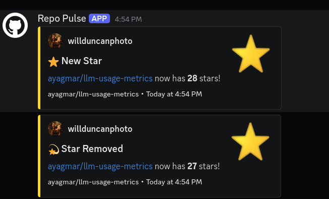

# Repo Pulse

<div align="center">

[](https://github.com/ayagmar/repo-pulse/actions/workflows/ci.yml)
[](https://codecov.io/gh/ayagmar/repo-pulse)
[](./LICENSE)
[](./package.json)
[](https://workers.cloudflare.com/)
[](https://hono.dev/)
[](https://developers.cloudflare.com/d1/)
[](./tsconfig.json)
[](https://deepwiki.com/ayagmar/repo-pulse)


</div>

<div align="center">
  
</div>

Repo Pulse posts activity from your GitHub repositories to a Discord channel: stars, forks, issues, pull requests, default-branch pushes, and releases. You run it yourself on your Cloudflare account, as a Worker with a D1 database. There is no hosted version.

<div align="center">
  
</div>

## Why not Discord's built-in GitHub webhook?

Discord accepts GitHub webhooks directly: add `/github` to a channel's webhook URL and give that to GitHub. If that is enough for you, use it. There is nothing to host.

Repo Pulse is for when you want to choose what gets announced and keep a record of what was sent:

- Pushes are announced only for the default branch, as one message with the latest commits. Bot pushes, branch deletions, and GitHub's own pull-request merge commits are skipped, because the merged pull request is announced already.
- Each repository's 10th, 25th, 50th, 100th, 250th, 500th, 1,000th, 2,500th, 5,000th star, and every 10,000 after that, goes to one star only, the first seen at or past it, whose alert becomes `🎉 myorg/repo reached 1,000 stars`, with who starred, how long since the previous milestone, and the net stars of the last seven days. A star removed and added back is not announced again, and a jump past two milestones announces the higher one. Milestones a repository had passed before this release are not announced late.
- When at least 5 people star a repository in 3 hours, and that is 4 times what it usually gets, one `📈` alert says so, at most once a day per repository. It names the latest stargazers, and with a GitHub token the most-followed ones and the sites sending visitors.
- Alerts are written to be read at a glance on a phone. The line above the title says who acted and in which repository (`razakiau · myorg/runnerd`), and the timestamp is the only thing below. Your own events, bots' and those of the logins in `PEOPLE_IGNORED_LOGINS` are posted silently (Discord's `SUPPRESS_NOTIFICATIONS` flag: the message lands in the channel, with no push). Outside people's events, force-pushes, star milestones, digests and the star-spike alert make a sound. "Your own" means the repository owner's login, so on a repository owned by an organisation, add your login to `PEOPLE_IGNORED_LOGINS` to make your events there silent. Which alerts are silent is decided once, when the event is accepted, so a retry never changes it.
- Pull request alerts carry one line of facts instead of fields: `by razakiau · +41 −41 in 22 files · 3 commits · merged 2h after opening · closes #190`. Release alerts show the number and size of their assets and what changed, not the download table. Excerpts of what people wrote are cut at a sentence, drop tables, HTML, images and link targets, never leave a code block open, and are left out for bots.
- Failed Discord sends are retried with backoff, following Discord's rate-limit headers, up to 5 attempts.
- If GitHub redelivers an event, it is not posted a second time (while the delivery is kept, 14 days by default).
- Every delivery and send attempt is stored in D1, and an authenticated admin API lists, inspects, and retries them.
- Every accepted event is also kept in a permanent event history, which is never pruned.
- Alerts say whether the person behind them is new or returning, across all your repositories: `👋 First event recorded from them`, or `↩️ Seen before: 12 events in 3 repos since 4 Mar 2026`. Your own events, bots and the logins in `PEOPLE_IGNORED_LOGINS` get no such line.
- Comments and reviews from outside people are announced with an excerpt and a link, and reviews say whether they approve or request changes. Your own, those of the logins in `PEOPLE_IGNORED_LOGINS`, and bots' are recorded without an alert, as are comment reviews with no text.
- Optionally, issue alerts get **Close** and **Label…** buttons. Only the Discord users you list can use them, they act on the issue the alert was about, only while its repository is public and not a fork, and the alert is updated to show what was done. See [SETUP.md](SETUP.md#discord-actions-optional).
- Each morning, one digest message, titled with its date (`📊 Daily pulse · Tue 3 Nov`), starts with one line of what a person would act on (`1 new star · 2 releases · 2 repos with unreleased work`), then sums up the previous day per repository: stars, commits, pull requests (bots' counted, `4 PRs merged (3 by bots)`, and only people's listed), issues, forks, and releases. It also lists repositories with commits since their latest release and how long ago it was. On Mondays a weekly digest covers the past seven days, lists the latest merged pull requests, and under "Who's showing up" names the week's five most active outside people, with `🆕` for those seen for the first time that week.
- Both digests start with "⏳ Waiting on you": open issues and pull requests where an outside person spoke last and nobody on your side has answered or closed it since, oldest wait first, such as `[myorg/repo#12](…) Crash on start · @alice · 3d`. The weekly digest adds "⏱️ Response times", the median time to merge for pull requests merged that week and to a first reply for threads first answered that week. A digest is skipped only when there was no activity and nobody is waiting. Comments were not recorded before this feature, so it counts from the first recorded comment or review; see [the system design](docs/system-design.md#waiting-on-you).

## Deploy

[](https://deploy.workers.cloudflare.com/?url=https://github.com/ayagmar/repo-pulse)

Generate the webhook secret first and keep it in a file. GitHub and Cloudflare never show it again, and the GitHub App needs the same value. Copy it to the clipboard to paste it into the form, rather than printing it:

```bash
mkdir -p ~/.config/repo-pulse
(umask 077; openssl rand -hex 32 | tr -d '\n' > ~/.config/repo-pulse/webhook-secret)
wl-copy < ~/.config/repo-pulse/webhook-secret   # macOS: pbcopy < ~/.config/repo-pulse/webhook-secret
```

Then create the [GitHub App](#connect-github): the button asks for its ID, installation ID and key. Its webhook URL is `https://repo-pulse.<your-subdomain>.workers.dev/webhook` before the Worker exists.

The button creates the D1 database in your Cloudflare account and asks for these secrets:

| Secret | Value |
| --- | --- |
| `GITHUB_WEBHOOK_SECRET` | the contents of `~/.config/repo-pulse/webhook-secret`, from the clipboard |
| `ADMIN_API_TOKEN` | another random string, for example from `openssl rand -hex 32` |
| `DISCORD_WEBHOOK_URL` | the Discord channel's webhook URL (Server Settings → Integrations → Webhooks) |
| `GITHUB_APP_ID`, `GITHUB_APP_INSTALLATION_ID` | the App's ID and its installation's ID |
| `GITHUB_APP_PRIVATE_KEY` | the App's private key, converted to PKCS#8 as [SETUP.md](SETUP.md#github-app) shows |

The committed `wrangler.jsonc` turns Discord actions on, which needs more secrets: in your copy, set `"DISCORD_ACTIONS": "off"` until you [set them up](SETUP.md#discord-actions-optional), or the Worker answers every request with a configuration error. It then runs `npm run deploy`, which applies the D1 migrations and deploys the Worker. To deploy from a clone with Wrangler instead, follow [SETUP.md](SETUP.md).

### Optional: a public-only GitHub token for the feed

`/public/feed` asks GitHub whether each repository is public. Without a token those
requests share GitHub's limit of 60 an hour per IP with every Worker on the same
Cloudflare egress IP, so the feed can answer `503`. Create a
[fine-grained personal access token](https://github.com/settings/personal-access-tokens/new)
with **Repository access: Public repositories** and no permissions, then add it:

```bash
npx wrangler secret put GITHUB_PUBLIC_TOKEN < ~/.config/repo-pulse/github-public-token
```

Do not use a token that can read private repositories here. With a public-only
token a private repository still answers `404`, and the feed also requires `"private": false`.

## Connect GitHub

GitHub has no account-wide webhooks, so events come from a GitHub App installed on all your repositories: a new repository is covered without setup, and the App's short-lived token lets digests and alerts read releases, commits, stargazers and referrers.

[SETUP.md](SETUP.md#github-app) has the steps: create the App with read permissions only (Metadata, Contents, Issues, Pull requests, Administration) and the Star, Fork, Issues, Issue comment, Pull request, Pull request review, Push and Release events, using the same webhook secret; install it on all repositories; and set `GITHUB_APP_ID`, `GITHUB_APP_INSTALLATION_ID` and `GITHUB_APP_PRIVATE_KEY` as secrets. All three are required. Deliveries from other installations, private repositories and forks are ignored, and so are repository webhooks.

## How it works

```text
GitHub webhook -> verify signature -> map RepoEvent -> persist in D1 -> return 202 -> notify Discord -> retry if needed
```

- `POST /webhook` receives the GitHub App's deliveries
- refuses missing GitHub headers or a malformed signature before reading the body
- verifies `X-Hub-Signature-256` against the exact raw body
- admits only deliveries from the configured installation, for public repositories that are not forks
- enforces request body size before JSON parsing
- normalizes supported payloads into one `RepoEvent` union
- writes accepted work to D1 before returning `202 Accepted`
- deduplicates using the GitHub delivery ID
- dispatches Discord notifications asynchronously with `waitUntil()`
- recovers retries and stale processing via cron-backed drains

## Supported events

| GitHub event | Internal event types |
| --- | --- |
| Stars | `star.created`, `star.deleted` |
| Issues | `issue.opened`, `issue.closed`, `issue.reopened` |
| Pull requests | `pull_request.opened`, `pull_request.closed`, `pull_request.merged`, `pull_request.reopened`; `pull_request.ready_for_review` and `pull_request.converted_to_draft` are recorded without an alert |
| Issue comments | `comment.created`, on issues and pull requests |
| Pull request reviews | `review.submitted` |
| Forks | `fork.created` |
| Pushes | `push.default_branch` |
| Releases | `release.published` (including pre-releases) |

Pushes are announced only for the repository's default branch, as one message with
the latest commits. Fast-forwarding the default branch to commits that were pushed to
another branch first is announced too. Bot pushes, branch deletions, and GitHub's own pull-request
merge or squash commits are skipped, since the merged pull request is announced
already. Rebase merges are not detected and are announced as a push.

Unsupported and skipped events are acknowledged with `200` and ignored, as are `ping`,
`installation` and `installation_repositories`, and deliveries that are not admitted.

## API surface

### Public routes

| Method | Path | Purpose |
| --- | --- | --- |
| `POST` | `/webhook` | GitHub webhook ingestion and acceptance |
| `GET` | `/public/feed?limit=50` | recent public activity and star history, read by ayagmar.dev |
| `GET` | `/public/activity?days=28` | public activity summed per UTC day, read by ayagmar.dev |
| `POST` | `/discord/interactions` | Discord's requests for the buttons on issue alerts; `404` unless `DISCORD_ACTIONS` is `on` |

`/public/feed` needs no token. It lists releases, stars, default-branch pushes and merged
pull requests from the last 90 days, newest first (`limit` from 1 to 100, default 50), plus
each repository's daily star count over the same 90 days. Each client may ask 10 times a
minute. A repository appears only while GitHub's
API says it is public, checked at most 60 seconds before the response,
and only its events that were recorded as public. No sender, body, label, commit
message or delivery state is published. When no repository is admitted and GitHub
did not answer for at least one of them, the feed answers
`503 {"error":"visibility_unavailable"}` instead of an empty list. The contract is
[ADR 0012 in ayagmar.dev](https://github.com/ayagmar/ayagmar.dev/blob/9ee31866d8751eb2de40c71536978d047d9a7c4b/docs/adr/0012-repo-pulse-public-feed.md).

`/public/activity` counts the same events over the whole history instead of the newest
100: one entry per UTC day for the last `days` days (1 to 400, default 28), oldest first
and ending today, with zeros for quiet days.

```json
{
  "generatedAt": "2026-11-01T14:00:00.000Z",
  "since": "2026-10-20",
  "complete": true,
  "days": [
    { "date": "2026-10-31", "pushes": 3, "commits": 9, "merges": 4, "releases": 1,
      "stars": 2,
      "repos": [
        { "repo": "ayagmar/ayagmar.dev", "pushes": 2, "commits": 7, "merges": 4,
          "releases": 0, "stars": 0 },
        { "repo": "ayagmar/pi-mobile", "pushes": 1, "commits": 2, "merges": 0,
          "releases": 1, "stars": 2 }
      ],
      "reposTruncated": false }
  ]
}
```

`pushes` are default-branch pushes and `commits` the commits they carried, `merges` merged
pull requests, `releases` published releases and `stars` new stars. `repos` breaks the day
down by repository, sorted by name, so its counts add up to the day's. Past 50 repositories
it keeps the 50 busiest and sets `reposTruncated`; the day's counts still include them all.
A response looks up at most 40 repositories on GitHub, like the feed, so on a cold isolate
a window with more active repositories than that leaves the least recently active ones out
until a request within the next 60 seconds looks them up. `complete` is `false` whenever a
repository in the window was left out that way, or because GitHub did not answer, so the
counts may be short; ask again before keeping them. Repositories GitHub says are not
public do not make an answer incomplete. `since` is the first UTC
day the history has a public event for, or `null`: days before it are zeros because
nothing was recorded yet. It has the feed's visibility check, errors, `no-store` header
and rate limit; the two routes share one budget of 10 requests a minute per client.

### Admin routes

All admin routes require:

```http
Authorization: Bearer <ADMIN_API_TOKEN>
```

| Method | Path | Purpose |
| --- | --- | --- |
| `GET` | `/admin/health` | lightweight operational health |
| `GET` | `/admin/status` | service status plus ledger stats |
| `GET` | `/admin/deliveries` | list persisted deliveries |
| `GET` | `/admin/deliveries/:deliveryId` | inspect one delivery and attempts |
| `POST` | `/admin/deliveries/:deliveryId/retry` | retry a failed delivery |
| `GET` | `/admin/events` | list the 50 most recent events from the permanent history |
| `GET` | `/admin/openapi.json` | authenticated OpenAPI document |
| `GET` | `/admin/docs` | authenticated Swagger UI |

## Metrics and operational numbers

Repo Pulse exposes delivery-ledger metrics directly from the admin surface.

### Delivery ledger metrics

Returned from `GET /admin/status`:

| Metric | Meaning |
| --- | --- |
| `total` | total tracked deliveries |
| `pending` | queued and waiting to be processed |
| `processing` | currently leased by a worker |
| `failed` | terminal failures after retry policy |
| `succeeded` | successfully delivered notifications |

Returned from `GET /admin/health`:

| Field | Meaning |
| --- | --- |
| `status` | current service health indicator |
| `providers` | configured notifier names |
| `trackedDeliveries` | current delivery count in the ledger |

### Runtime defaults

These defaults are committed in `wrangler.jsonc` and `src/config/delivery-policy.ts`:

| Setting | Value |
| --- | --- |
| Webhook max body | `1,048,576` bytes |
| Max delivery attempts | `5` |
| Retry base delay | `30s` |
| Retry max delay | `15m` |
| Succeeded retention | `14 days` |
| Processing lease | `5m` |
| Drain batch size | `5` (keeps a run within the Free plan's 50 subrequests) |
| Cron cadence | every minute |
| Digest time | `09:00` in `DIGEST_TIME_ZONE` (`Africa/Casablanca`) |

## Architecture in one screen

- **Edge route:** reads the raw request stream and validates the GitHub signature
- **Event mapping:** converts inbound payloads into strict domain events
- **D1 ledger:** stores accepted deliveries, dedupe state, attempts, and retry metadata
- **Event history:** keeps every accepted event in D1 after its delivery row is pruned
- **Background processor:** drains due work, dispatches providers, reschedules transient failures, and prunes old succeeded rows
- **Digests:** the cron posts one summary of the previous day, and on Mondays one of the past week, from the event history, with who is waiting for an answer
- **Star radar:** every ten minutes, the cron looks for repositories gaining stars much faster than usual and alerts once a day per repository
- **Admin surface:** exposes status, health, delivery history, retries, OpenAPI, and Swagger UI

Related docs:

- [Architecture summary](ARCHITECTURE.md)
- [System design](docs/system-design.md)
- [Setup guide](SETUP.md)
- [Operations guide](docs/operations.md)
- [Production CPU and heap profiling](docs/profiling.md)

## Local development

Use Node 24 LTS (`nvm use`) and npm 12.2.0. Node 22.22.2+ is also supported;
see `engines` in `package.json` for the exact ranges.

```bash
npm ci
cp .dev.vars.example .dev.vars
npm run db:migrate:local
npm run typegen
npm run dev
```

Fill in `.dev.vars` with test values first. Wrangler serves the app on `http://127.0.0.1:8787`.

## Tooling

- Runtime: Cloudflare Workers
- Framework: Hono
- Durable storage: D1
- Language: TypeScript
- Package manager workflow: npm
- Local platform tooling: Wrangler
- Verification: Vitest, ESLint, Biome, Knip

## Verification commands

```bash
npm run check:secrets
npm run typegen
npm run typecheck
npm run lint
npm run check:ci
npm run test
npm run test:workers
npm run knip
npm run build
```

`check:secrets` fails on a private key, a GitHub token, a Discord webhook URL, or a
value for a credential or owner identifier (such as `ADMIN_API_TOKEN` or `GITHUB_APP_ID`)
that is not a placeholder, in any tracked file. It catches labelled and recognizable
leaks only; an unlabelled random string still needs a reviewer.

## Guarantees

- supported deliveries are persisted before `POST /webhook` returns `202 Accepted`
- duplicate delivery IDs return `200` and do not enqueue a second delivery while the ledger row is retained
- notification dispatch is asynchronous and recoverable; provider sends are at-least-once when an invocation is interrupted
- retries and stale-processing recovery are driven from D1 state plus cron
- admin routes stay protected by bearer auth
- the public feed and daily activity show a repository only while GitHub confirms it is public, never from an answer older than 60 seconds
- Discord buttons act only for allow-listed users, after Discord's signature is checked, on the issue recorded for the alert, only while GitHub confirms its repository is public and not a fork; a replayed request acts at most once

## Repo navigation

```text
src/http/routes/webhook.ts      webhook ingestion
src/http/routes/admin.ts        admin API surface
src/http/routes/public-feed.ts  public feed and daily activity for ayagmar.dev
src/http/routes/discord-interactions.ts  Close and Label buttons on issue alerts
src/http/openapi.ts             OpenAPI document + Swagger UI page
src/core/services/d1-delivery-ledger.ts
src/core/services/durable-event-processor.ts
src/providers/github/           payload verification + event mapping
src/providers/discord/          embed formatting + delivery transport
scripts/check-secrets.sh        fails on credentials in tracked files
```
