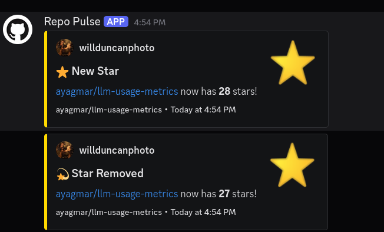

# Repo Pulse

<div align="center">

[](https://github.com/ayagmar/repo-pulse/actions/workflows/ci.yml)
[](https://codecov.io/gh/ayagmar/repo-pulse)
[](./LICENSE)
[](./package.json)
[](https://workers.cloudflare.com/)
[](https://hono.dev/)
[](https://developers.cloudflare.com/d1/)
[](./tsconfig.json)
[](https://deepwiki.com/ayagmar/repo-pulse)


</div>

<div align="center">
  
</div>

Repo Pulse posts activity from your GitHub repositories to a Discord channel: stars, forks, issues, pull requests, default-branch pushes, and releases. You run it yourself on your Cloudflare account, as a Worker with a D1 database. There is no hosted version.

<div align="center">
  
</div>

## Why not Discord's built-in GitHub webhook?

Discord accepts GitHub webhooks directly: add `/github` to a channel's webhook URL and give that to GitHub. If that is enough for you, use it. There is nothing to host.

Repo Pulse is for when you want to choose what gets announced and keep a record of what was sent:

- Pushes are announced only for the default branch, as one message with the latest commits. Bot pushes, branch deletions, and GitHub's own pull-request merge commits are skipped, because the merged pull request is announced already.
- A star that reaches 10, 25, 50, 100, 250, 500, 1,000, 2,500, 5,000, or a multiple of 10,000 is announced as a milestone. A star removed and added back at that count is announced again.
- When at least 5 people star a repository in 3 hours, and that is 4 times what it usually gets, one alert says so, at most once a day per repository. With a GitHub token, it names the most-followed new stargazers and the sites sending visitors.
- Failed Discord sends are retried with backoff, following Discord's rate-limit headers, up to 5 attempts.
- If GitHub redelivers an event, it is not posted a second time (while the delivery is kept, 14 days by default).
- Every delivery and send attempt is stored in D1, and an authenticated admin API lists, inspects, and retries them.
- Every accepted event is also kept in a permanent event history, which is never pruned.
- Each morning, one digest message sums up the previous day per repository: stars, commits, pull requests, issues, forks, and releases. It is skipped after a day without activity. With a GitHub token, it also lists repositories with commits since their latest release. On Mondays a weekly digest covers the past seven days and lists the latest merged pull requests.

## Deploy

[](https://deploy.workers.cloudflare.com/?url=https://github.com/ayagmar/repo-pulse)

Generate the webhook secret first and keep it in a file. GitHub and Cloudflare never show it again, and you need it for every repository you subscribe:

```bash
mkdir -p ~/.config/repo-pulse
(umask 077; openssl rand -hex 32 | tr -d '\n' > ~/.config/repo-pulse/webhook-secret)
cat ~/.config/repo-pulse/webhook-secret
```

The button creates the D1 database in your Cloudflare account and asks for three secrets:

| Secret | Value |
| --- | --- |
| `GITHUB_WEBHOOK_SECRET` | the contents of `~/.config/repo-pulse/webhook-secret` |
| `ADMIN_API_TOKEN` | another random string, for example from `openssl rand -hex 32` |
| `DISCORD_WEBHOOK_URL` | the Discord channel's webhook URL (Server Settings → Integrations → Webhooks) |

It then runs `npm run deploy`, which applies the D1 migrations and deploys the Worker. To deploy from a clone with Wrangler instead, follow [SETUP.md](SETUP.md).

### Optional: a GitHub token

With a GitHub token, the daily digest also lists repositories with commits on the default branch since their latest release, and star alerts name notable stargazers and top referrers. Create a [fine-grained personal access token](https://github.com/settings/personal-access-tokens/new) with read-only access to your repositories and two permissions: **Contents: read** for releases and commits, and **Administration: read** for traffic referrers. Then add it:

```bash
npx wrangler secret put GITHUB_TOKEN
```

Without the token, or when GitHub does not answer, digests and alerts are posted without those details.

## Subscribe repositories

GitHub has no account-wide webhooks, so each repository needs its own. With the [GitHub CLI](https://cli.github.com/) logged in as a repository admin:

```bash
just subscribe https://repo-pulse.<your-subdomain>.workers.dev owner/repo owner/other-repo
```

Without `just`, run `scripts/subscribe.sh` with the same arguments. It adds a webhook for the six supported events, signed with the secret in `~/.config/repo-pulse/webhook-secret` (set `REPO_PULSE_SECRET_FILE` to use another file), and skips repositories that already send to that URL.

GitHub pings each new webhook. The repository's **Settings → Webhooks → Recent Deliveries** shows the result: `200` means the secret matches, `401` means it does not.

## How it works

```text
GitHub webhook -> verify signature -> map RepoEvent -> persist in D1 -> return 202 -> notify Discord -> retry if needed
```

- `POST /webhook` receives GitHub webhook deliveries
- verifies `X-Hub-Signature-256` against the exact raw body
- enforces request body size before JSON parsing
- normalizes supported payloads into one `RepoEvent` union
- writes accepted work to D1 before returning `202 Accepted`
- deduplicates using the GitHub delivery ID
- dispatches Discord notifications asynchronously with `waitUntil()`
- recovers retries and stale processing via cron-backed drains

## Supported events

| GitHub event | Internal event types |
| --- | --- |
| Stars | `star.created`, `star.deleted` |
| Issues | `issue.opened`, `issue.closed`, `issue.reopened` |
| Pull requests | `pull_request.opened`, `pull_request.closed`, `pull_request.merged`, `pull_request.reopened` |
| Forks | `fork.created` |
| Pushes | `push.default_branch` |
| Releases | `release.published` (including pre-releases) |

Pushes are announced only for the repository's default branch, as one message with
the latest commits. Fast-forwarding the default branch to commits that were pushed to
another branch first is announced too. Bot pushes, branch deletions, and GitHub's own pull-request
merge or squash commits are skipped, since the merged pull request is announced
already. Rebase merges are not detected and are announced as a push.

Unsupported and skipped events are acknowledged with `200` and ignored.

## API surface

### Public route

| Method | Path | Purpose |
| --- | --- | --- |
| `POST` | `/webhook` | GitHub webhook ingestion and acceptance |

### Admin routes

All admin routes require:

```http
Authorization: Bearer <ADMIN_API_TOKEN>
```

| Method | Path | Purpose |
| --- | --- | --- |
| `GET` | `/admin/health` | lightweight operational health |
| `GET` | `/admin/status` | service status plus ledger stats |
| `GET` | `/admin/deliveries` | list persisted deliveries |
| `GET` | `/admin/deliveries/:deliveryId` | inspect one delivery and attempts |
| `POST` | `/admin/deliveries/:deliveryId/retry` | retry a failed delivery |
| `GET` | `/admin/events` | list the 50 most recent events from the permanent history |
| `GET` | `/admin/openapi.json` | authenticated OpenAPI document |
| `GET` | `/admin/docs` | authenticated Swagger UI |

## Metrics and operational numbers

Repo Pulse exposes delivery-ledger metrics directly from the admin surface.

### Delivery ledger metrics

Returned from `GET /admin/status`:

| Metric | Meaning |
| --- | --- |
| `total` | total tracked deliveries |
| `pending` | queued and waiting to be processed |
| `processing` | currently leased by a worker |
| `failed` | terminal failures after retry policy |
| `succeeded` | successfully delivered notifications |

Returned from `GET /admin/health`:

| Field | Meaning |
| --- | --- |
| `status` | current service health indicator |
| `providers` | configured notifier names |
| `trackedDeliveries` | current delivery count in the ledger |

### Runtime defaults

These defaults are committed in `wrangler.jsonc` and `src/config/delivery-policy.ts`:

| Setting | Value |
| --- | --- |
| Webhook max body | `1,048,576` bytes |
| Max delivery attempts | `5` |
| Retry base delay | `30s` |
| Retry max delay | `15m` |
| Succeeded retention | `14 days` |
| Processing lease | `5m` |
| Drain batch size | `5` (keeps a run within the Free plan's 50 subrequests) |
| Cron cadence | every minute |
| Digest time | `09:00` in `DIGEST_TIME_ZONE` (`Africa/Casablanca`) |

## Architecture in one screen

- **Edge route:** reads the raw request stream and validates the GitHub signature
- **Event mapping:** converts inbound payloads into strict domain events
- **D1 ledger:** stores accepted deliveries, dedupe state, attempts, and retry metadata
- **Event history:** keeps every accepted event in D1 after its delivery row is pruned
- **Background processor:** drains due work, dispatches providers, reschedules transient failures, and prunes old succeeded rows
- **Digests:** the cron posts one summary of the previous day, and on Mondays one of the past week, from the event history
- **Star radar:** every ten minutes, the cron looks for repositories gaining stars much faster than usual and alerts once a day per repository
- **Admin surface:** exposes status, health, delivery history, retries, OpenAPI, and Swagger UI

Related docs:

- [Architecture summary](ARCHITECTURE.md)
- [System design](docs/system-design.md)
- [Setup guide](SETUP.md)
- [Operations guide](docs/operations.md)
- [Production CPU and heap profiling](docs/profiling.md)

## Local development

Use Node 24 LTS (`nvm use`) and npm 12.2.0. Node 22.22.2+ is also supported;
see `engines` in `package.json` for the exact ranges.

```bash
npm ci
cp .dev.vars.example .dev.vars
npm run db:migrate:local
npm run typegen
npm run dev
```

Fill in `.dev.vars` with test values first. Wrangler serves the app on `http://127.0.0.1:8787`.

## Tooling

- Runtime: Cloudflare Workers
- Framework: Hono
- Durable storage: D1
- Language: TypeScript
- Package manager workflow: npm
- Local platform tooling: Wrangler
- Verification: Vitest, ESLint, Biome, Knip

## Verification commands

```bash
npm run typegen
npm run typecheck
npm run lint
npm run check:ci
npm run test
npm run test:workers
npm run knip
npm run build
```

## Guarantees

- supported deliveries are persisted before `POST /webhook` returns `202 Accepted`
- duplicate delivery IDs return `200` and do not enqueue a second delivery while the ledger row is retained
- notification dispatch is asynchronous and recoverable; provider sends are at-least-once when an invocation is interrupted
- retries and stale-processing recovery are driven from D1 state plus cron
- admin routes stay protected by bearer auth

## Repo navigation

```text
src/http/routes/webhook.ts      webhook ingestion
src/http/routes/admin.ts        admin API surface
src/http/openapi.ts             OpenAPI document + Swagger UI page
src/core/services/d1-delivery-ledger.ts
src/core/services/durable-event-processor.ts
src/providers/github/           payload verification + event mapping
src/providers/discord/          embed formatting + delivery transport
scripts/subscribe.sh            adds the webhook to GitHub repositories
```
