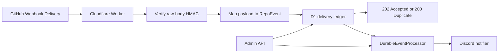
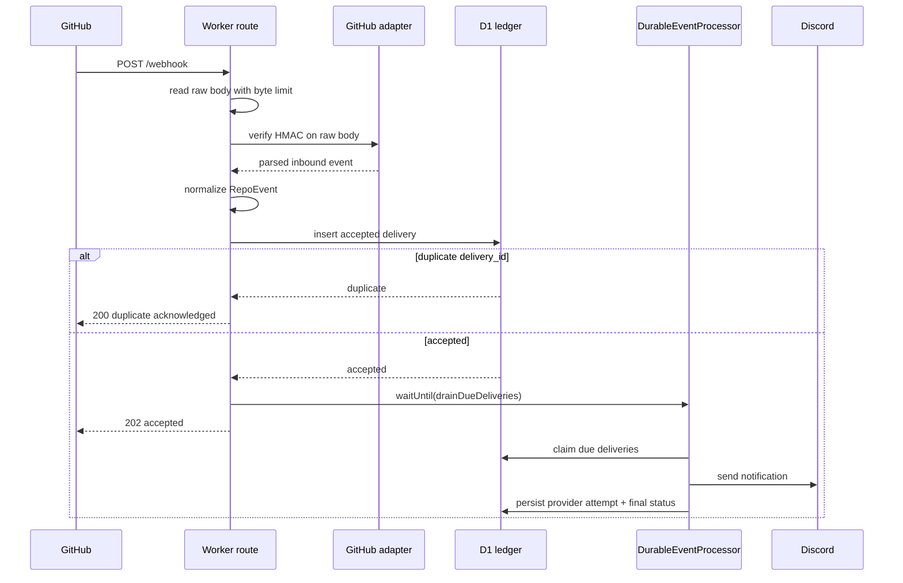
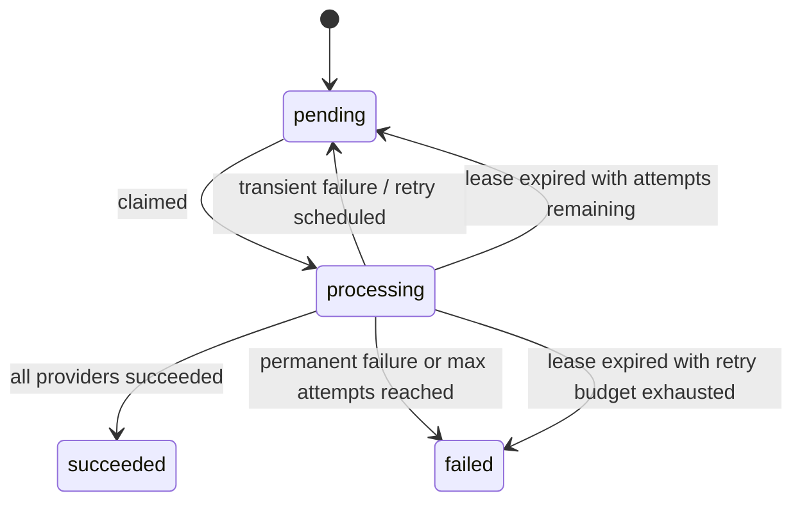

# System Design

## Overview

Repo Pulse is a webhook ingestion and notification pipeline built for Cloudflare Workers. It accepts GitHub deliveries, verifies the exact request body with HMAC, maps supported events into a strict domain union, stores accepted work in D1, and dispatches provider notifications asynchronously.

## High-Level Design

## Webhook Request Flow

## Delivery Lifecycle

## Components

### Webhook edge

- Reads the raw request stream directly so HMAC verification matches GitHub’s original bytes.
- Rejects oversized requests before JSON parsing.
- Verifies the original bytes before UTF-8 decoding and JSON parsing.
- Rejects invalid supported payloads with standardized JSON errors; unsupported events are acknowledged and ignored.

### Domain mapping

- `providers/github/` normalizes GitHub payloads into strict `RepoEvent` variants.
- Unsupported events are acknowledged without entering the notification pipeline.

### Durable ledger

- D1 is the canonical persistence boundary.
- `delivery_id` is the dedupe key.
- Delivery rows store normalized event payload, status, attempt counters, retry timing, lease metadata, and latest failure context.
- Provider attempt rows preserve historical send attempts per delivery and provider. A retry skips the providers that already succeeded for that delivery.

### Event history

- The `events` table keeps every accepted event, keyed by `delivery_id`, and is never pruned. It is the source for anything that reads past activity, such as a website feed or a digest.
- The ledger inserts the history row in the same D1 batch as the delivery row. A redelivery that arrives after its delivery row was pruned is queued again but not recorded twice.
- Each stored event includes `repository.private`, so readers can leave private repositories out. Events backfilled from the ledger by migration `0004` predate that field and are recorded as private.
- `GET /admin/events` lists the 50 most recent events.

### Public feed

- `GET /public/feed` is unauthenticated and read-only. ayagmar.dev's signals Worker pulls it every 15 minutes. The contract (ADR 0012) and its JSON Schema live in ayagmar.dev; a copy of the schema validates the output in `src/__tests__/public-feed.test.ts`.
- One D1 read per `limit` value builds the material: the newest `limit` events of the four published types, and the last star count of each UTC day in the last 90 for every repository. Only events whose stored `repository.private` is JSON `false` are read, and only the fields the feed publishes. The material is cached in the Cache API for 300 seconds under `https://repo-pulse.internal/...`, a host the route never serves. On `*.workers.dev` the Cache API may store nothing; every request then reads D1.
- Each response checks every repository it would show with `GET https://api.github.com/repos/{owner}/{repo}` (no redirects, three-second timeout). The request carries `GITHUB_PUBLIC_TOKEN` when set, a token that can read public repositories only, so a private repository answers `404` as it would without a token; never `GITHUB_TOKEN`. Only a `200` whose body has `"private": false` admits it; a `404`, a rate limit, an error, a timeout or an unreadable body leaves it out. Each answer is cached in the isolate for 60 seconds, counted from when the lookup was sent. The answers are read again after the last lookup of the response settles, so one that expired in the meantime does not count.
- A response makes at most 40 GitHub lookups, so it stays within the Free plan's 50 subrequests with the cache and D1 reads. Repositories past that are left out of that response, oldest activity first.
- Values that would break the schema, such as a URL outside `https://github.com/` or a malformed count, drop their event or star-history day.
- The response is sent with `Cache-Control: no-store`, so no copy outlives the visibility check. Errors are `400 {"error":"invalid_query"}`, `405` and `500 {"error":"internal_error"}`, without details.

### Digests

- The every-minute cron checks the local time in `DIGEST_TIME_ZONE`. During the first ten minutes after `DIGEST_HOUR`, it summarizes the events received since that hour on the previous local day and sends one message per provider.
- Both ends of the window come from the same local-hour instant, so consecutive digests meet exactly. Across a clock change a window lasts 23 or 25 hours; Morocco, for example, moved to UTC+0 on 20 September 2026. A digest hour repeated by a clock change uses its first occurrence, and one skipped by a clock change moves forward by the gap, into the next day if need be (23:00 in America/Nuuk each March).
- Each provider claims the digest in `digest_sends` before posting. A claim held by another run blocks a second post for five minutes; a failed post releases it so the next minute retries, and a sent digest is not repeated.
- With `GITHUB_TOKEN` set, the daily digest asks GitHub's GraphQL API about the 20 repositories most recently active in the last 30 days: one query for each one's latest release and default branch, one for how many commits the branch has since that release's tag. Up to five repositories with new commits are listed, most commits first. If GitHub fails, the digest is posted without them and a warning is logged.
- On Mondays a weekly digest is sent at the same hour. It covers the seven local days since the previous Monday's digest hour and lists up to three merged pull requests per repository. It is claimed under its own id, such as `weekly:2026-10-19`, next to `daily:2026-10-19`.
- Days without events get no digest.

### Star radar

- Every ten minutes, at minute 5 of each ten, the cron counts the people who starred each repository in the last 3 hours. Counting people rather than `star.created` events means one person toggling a star cannot set it off.
- For repositories with at least 5, not cooling down, it also counts their stars in the 14 days before. A repository is spiking when its recent count is at least 4 times the average for a 3-hour window over those 14 days. A repository with less than 14 days of history looks quieter than it is, so its first spikes alert more easily.
- Each check reads the stars of the last 3 hours, plus the 14-day stars of those candidates. A repository steadily starred by 5 or more people every 3 hours is a candidate at every check, so it costs its 14-day star count in D1 reads 144 times a day.
- Each alert is claimed in `radar_alerts` as `stars:<owner/repo>` before it is posted. Once sent, it blocks another alert for that repository for 24 hours. If every provider fails, the claim is released. If the check fails before either, the claim's five-minute lease runs out before the next check, which retries.
- With `GITHUB_TOKEN`, the alert looks up the last 20 stargazers' follower counts in one GraphQL request and lists up to three with at least 100 followers. It also lists the top three referrers from the traffic API. Either lookup can fail without blocking the alert.

### Background processor

- Claims due rows from D1 in batches.
- Persists `processing` leases to recover from interrupted invocations.
- Reschedules transient failures with backoff.
- Fences outcome updates by processing attempt and prevents admin retries from resetting active work.
- Counts interruptions against the retry budget, including exhausted pending rows from previous releases.
- Leaves processing leases recoverable when a D1 outcome write fails.
- Prunes succeeded deliveries based on retention policy.

### Admin surface

- Protected by `Authorization: Bearer <ADMIN_API_TOKEN>`.
- Lists deliveries, shows details, retries eligible failures, exposes OpenAPI, and serves Swagger UI.

## Why This Shape

- Workers do not offer an always-on process, so the design moves durability into D1 instead of memory.
- `waitUntil()` gives fast follow-up execution after acceptance, while the cron trigger guarantees retries and stale-lease recovery continue even without steady inbound traffic.
- The route writes accepted work before success to preserve the original service’s durability semantics as closely as Workers allows.

## Constraints

- Retry execution is durable, but exact execution time is bounded by cron cadence and Worker scheduling.
- Notification dispatch is asynchronous; `202 Accepted` means persisted and queued, not fully delivered.
- Provider sends are at-least-once on interruption. Delivery-ID dedupe applies only while the ledger row is retained.
- Newest-first delivery lists use indexed ordering and indexed per-row attempt counts, not full-ledger aggregation.
- Runtime code avoids filesystem-only and non-Workers APIs. Test code may use local SQLite only as a D1-compatible harness.
