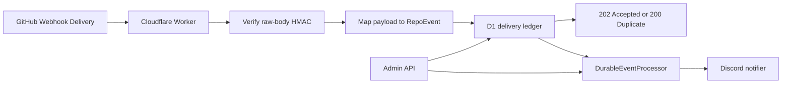
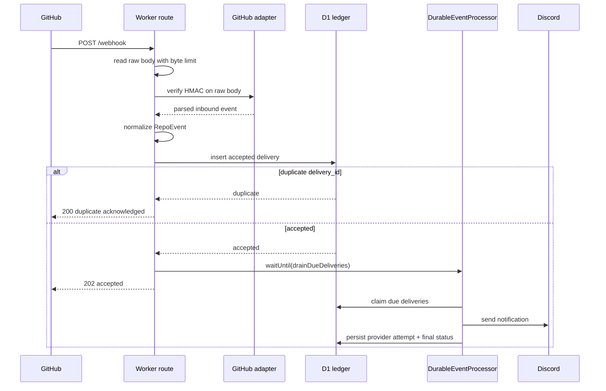
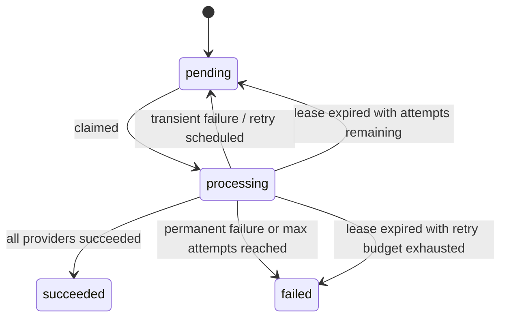

# System Design

## Overview

Repo Pulse is a webhook ingestion and notification pipeline built for Cloudflare Workers. It accepts GitHub deliveries, verifies the exact request body with HMAC, maps supported events into a strict domain union, stores accepted work in D1, and dispatches provider notifications asynchronously.

## High-Level Design

## Webhook Request Flow

## Delivery Lifecycle

## Components

### Webhook edge

- Reads the raw request stream directly so HMAC verification matches GitHub’s original bytes.
- Rejects oversized requests before JSON parsing.
- Verifies the original bytes before UTF-8 decoding and JSON parsing.
- Rejects invalid supported payloads with standardized JSON errors; unsupported events are acknowledged and ignored.

### Domain mapping

- `providers/github/` normalizes GitHub payloads into strict `RepoEvent` variants.
- Unsupported events are acknowledged without entering the notification pipeline.

### Durable ledger

- D1 is the canonical persistence boundary.
- `delivery_id` is the dedupe key.
- Delivery rows store normalized event payload, status, attempt counters, retry timing, lease metadata, and latest failure context.
- Provider attempt rows preserve historical send attempts per delivery and provider. A retry skips the providers that already succeeded for that delivery.

### Event history

- The `events` table keeps every accepted event, keyed by `delivery_id`, and is never pruned. It is the source for anything that reads past activity, such as a website feed or a digest.
- The ledger inserts the history row in the same D1 batch as the delivery row. A redelivery that arrives after its delivery row was pruned is queued again but not recorded twice.
- Each stored event includes `repository.private`, so readers can leave private repositories out. Events backfilled from the ledger by migration `0004` predate that field and are recorded as private.
- `GET /admin/events` lists the 50 most recent events.

### Daily digest

- The every-minute cron checks the local time in `DIGEST_TIME_ZONE`. During the first ten minutes after `DIGEST_HOUR`, it summarizes the events received since that hour on the previous local day and sends one message per provider.
- Both ends of the window come from the same local-hour instant, so consecutive digests meet exactly. Across a clock change a window lasts 23 or 25 hours; Morocco, for example, moved to UTC+0 on 20 September 2026. A digest hour repeated by a clock change uses its first occurrence, and one skipped by a clock change moves forward by the gap.
- Each provider claims the digest in `digest_sends` before posting. A claim held by another run blocks a second post for five minutes; a failed post releases it so the next minute retries, and a sent digest is not repeated.
- Days without events get no digest.

### Background processor

- Claims due rows from D1 in batches.
- Persists `processing` leases to recover from interrupted invocations.
- Reschedules transient failures with backoff.
- Fences outcome updates by processing attempt and prevents admin retries from resetting active work.
- Counts interruptions against the retry budget, including exhausted pending rows from previous releases.
- Leaves processing leases recoverable when a D1 outcome write fails.
- Prunes succeeded deliveries based on retention policy.

### Admin surface

- Protected by `Authorization: Bearer <ADMIN_API_TOKEN>`.
- Lists deliveries, shows details, retries eligible failures, exposes OpenAPI, and serves Swagger UI.

## Why This Shape

- Workers do not offer an always-on process, so the design moves durability into D1 instead of memory.
- `waitUntil()` gives fast follow-up execution after acceptance, while the cron trigger guarantees retries and stale-lease recovery continue even without steady inbound traffic.
- The route writes accepted work before success to preserve the original service’s durability semantics as closely as Workers allows.

## Constraints

- Retry execution is durable, but exact execution time is bounded by cron cadence and Worker scheduling.
- Notification dispatch is asynchronous; `202 Accepted` means persisted and queued, not fully delivered.
- Provider sends are at-least-once on interruption. Delivery-ID dedupe applies only while the ledger row is retained.
- Newest-first delivery lists use indexed ordering and indexed per-row attempt counts, not full-ledger aggregation.
- Runtime code avoids filesystem-only and non-Workers APIs. Test code may use local SQLite only as a D1-compatible harness.
