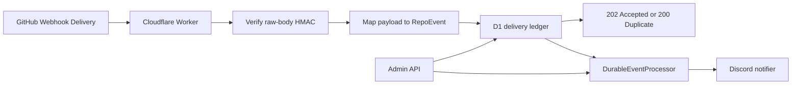
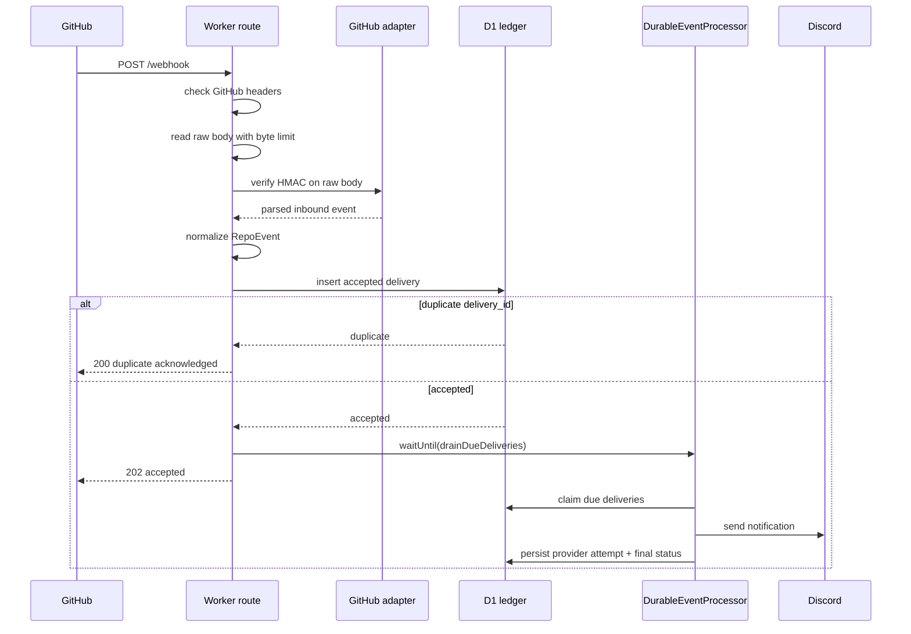
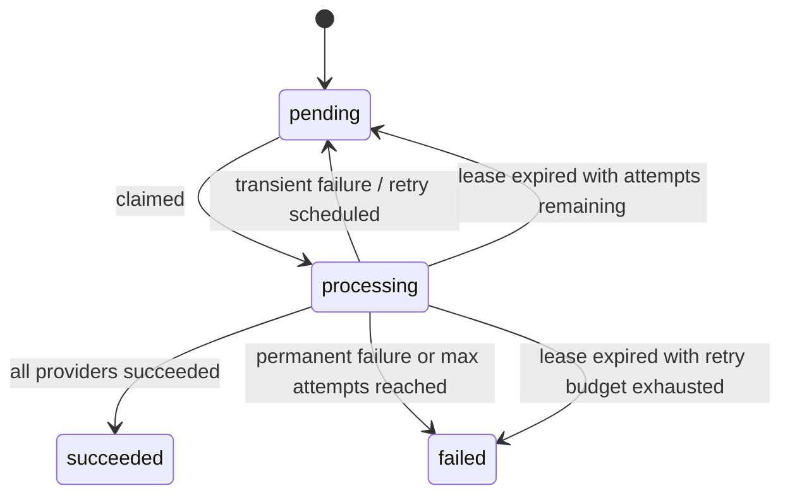

# System Design

## Overview

Repo Pulse is a webhook ingestion and notification pipeline built for Cloudflare Workers. It accepts GitHub deliveries, verifies the exact request body with HMAC, maps supported events into a strict domain union, stores accepted work in D1, and dispatches provider notifications asynchronously.

## High-Level Design

## Webhook Request Flow

## Delivery Lifecycle

## Components

### Webhook edge

- Before reading the body, in order: `X-GitHub-Event` and `X-GitHub-Delivery` present (`400`), then `X-Hub-Signature-256` is `sha256=` and 64 hex digits (`401`). A request refused there costs no body read, D1 query or provider call.
- `POST /webhook` has no rate limit, unlike `/public/feed` and `/discord/interactions`. A limit before authentication can only key on the client address, and GitHub delivers every customer's webhooks from the same shared ranges: anyone can point their own webhooks at this URL and fill the bucket that the owner's deliveries share. GitHub does not retry a refused delivery, so that would lose alerts. A stranger can still make the Worker read and HMAC up to `WEBHOOK_MAX_BODY_BYTES` per request with well-formed headers; nothing after the HMAC runs for them.
- Reads the raw request stream directly so HMAC verification matches GitHub’s original bytes.
- Rejects oversized requests before JSON parsing.
- Verifies the original bytes before UTF-8 decoding and JSON parsing.
- Acknowledges `ping`, `installation` and `installation_repositories` once signed, without a repository if need be.
- Admits only the GitHub App's deliveries: from the configured installation and from a public repository that is not a fork. The rest, repository webhooks included, are acknowledged and ignored.
- Rejects invalid supported payloads with standardized JSON errors; unsupported events are acknowledged and ignored.

### Domain mapping

- `providers/github/` normalizes GitHub payloads into strict `RepoEvent` variants.
- Unsupported events are acknowledged without entering the notification pipeline.

### Durable ledger

- D1 is the canonical persistence boundary.
- `delivery_id` is the dedupe key.
- Delivery rows store normalized event payload, status, attempt counters, retry timing, lease metadata, and latest failure context.
- Provider attempt rows preserve historical send attempts per delivery and provider. A retry skips the providers that already succeeded for that delivery.

### Event history

- The `events` table keeps every accepted event, keyed by `delivery_id`, and is never pruned. It is the source for anything that reads past activity, such as a website feed or a digest.
- The ledger inserts the history row first, then in the same D1 batch the delivery row, which copies the event from the history row. A redelivery that arrives after its delivery row was pruned is queued again with the event as first recorded, not recorded twice.
- Each stored event includes `repository.private`, so readers can leave private repositories out. Events backfilled from the ledger by migration `0004` predate that field and are recorded as private.
- `GET /admin/events` lists the 50 most recent events.
- `timestamp` is when the Worker accepted the event. Issue, pull request, comment and review events also store `occurredAt`, GitHub's time for the action: `created_at` for an open, `closed_at` for a close, `merged_at` for a merge, the comment's `created_at`, the review's `submitted_at`, and `updated_at` for a reopen or a draft change, which have no time of their own. A missing or invalid time is left out, not refused. Issues and pull requests also store their `createdAt`. Events stored before this release have neither.
- Whether an event alerts is decided once, at acceptance, and stored on it: `alert: false` marks an event recorded for history only, and the delivery insert copies only events without it. Such an event gets no delivery row and no provider attempt, and is answered `202` with "Webhook recorded without an alert". A redelivery, before or after its delivery row was pruned, finds the stored event and is not queued, whatever `PEOPLE_IGNORED_LOGINS` says by then. Events without the field, every one stored before it existed included, alert as before. History-only are: comments and reviews not from an outside person (see [People](#people)), comment reviews without text (the shell GitHub submits around inline comments), reviews in a state other than `approved`, `changes_requested` or `commented`, and `pull_request.ready_for_review` and `pull_request.converted_to_draft`.

### People

- People are identified by `sender.id` across all repositories; the login shown is the latest one seen. Migration `0007` indexes `events` on `json_extract(event_json, '$.sender.id'), received_at`, so reads about one person touch only that person's rows.
- Outside people are everyone except the repository's owner, logins in `PEOPLE_IGNORED_LOGINS` (comma-separated, case-insensitive) and logins ending in `[bot]`. Events without a numeric sender id are left out too.
- When `POST /webhook` accepts an event from an outside person, the history insert counts the sender's earlier events (count, distinct repositories, events in this repository, first seen) and stores them on the event as `senderHistory`, in the same statement. Two deliveries from one person arriving together are therefore counted in the order they are inserted, and only the first can be a first time. The Discord alert renders it as one line. A delivery id already recorded keeps its stored event, whoever the sender is and whatever `PEOPLE_IGNORED_LOGINS` says now, so a redelivery after its delivery row was pruned keeps its original text, with or without `senderHistory`.
- The history is optional. If persisting with it fails, `people.history_read_failed` is logged, without the exception text, and the event is persisted again without it; the alert has no history line rather than a wrong one. If that fails too, the request fails as before.
- The weekly digest groups the week's events, already read for the digest, by sender id and keeps outside people, most distinct repositories first, then most events, then lowest sender id, up to five. One more query reads each one's first event through the sender index; a person first seen inside the week is marked `🆕`. If that read fails, `people.digest_read_failed` is logged, without the exception text, and the digest is posted without the section.
- `senderHistory` is optional on stored events. Events stored before it existed, and a previous release reading new events, both ignore it. The public feed reads fixed JSON paths and never publishes it.

### Waiting on you

Each digest lists open threads (issues and pull requests, keyed by repository id and number, so a renamed repository keeps its threads) where an outside person waits for the owner's side, and the weekly digest adds median merge and first-reply times. All of it is computed from stored events. It is a heuristic over observed activity: it does not read whether a comment asks anything.

- **Sides.** The owner's side is the repository's owner and the logins in `PEOPLE_IGNORED_LOGINS`, compared case-insensitively, read at digest time. Outside people are as in [People](#people). Bots, and senders without a numeric id or a login, are on neither side: they never answer and never make anyone wait.
- **Requests and answers.** An outside person opening or reopening the thread, commenting, or submitting a review that requests changes or comments with text is a request. An approval is not. A comment, or a review that approves, requests changes or comments with text, from the owner's side is an answer. Closing or merging, by anyone (Discord's Close button acts as the App's bot), ends a wait without being an answer. Labels are not recorded and are not answers.
- **Waiting.** A thread waits when its latest state is open, it is not a draft pull request, and a request came after the latest answer and the latest close or merge. It waits since the first such request, and the listed person is who made it. Events are ordered by GitHub's time, then receipt time, then delivery id; GitHub's times have whole seconds, so events in the same second keep their arrival order. The state is the newest event's: every issue, pull request, comment and review event carries the thread's state at that time, from bots too. A pull request's draft state comes from the newest event that says it; a comment's payload often does not, so a pull request known only from comments that do not say is not listed until an event says it is not a draft. Becoming ready for review shows a request that came while it was a draft; converting to draft hides it.
- **Activation.** Comments and reviews were not recorded before this release, so an earlier answer cannot be known. The first comment or review accepted with a valid GitHub time writes that time to `feature_activations` in the same D1 batch as its event (it counts itself); later deliveries, older ones included, never move it, and applying migration `0010` writes nothing. Requests before that instant are ignored, and until it exists the section is empty. This is where observation starts, not a claim that earlier threads were answered. Merge times do not depend on it.
- **Events without GitHub's time.** Events stored before this release have none, and a review can arrive with a null `submitted_at`. Receipt never precedes occurrence, so one received before activation happened before it, and its receipt time orders it among what came before activation, which no wait or first reply counts from. One received since could have happened any time before it arrived: the thread is left out of the waiting list and first replies rather than ordered by a guess, and counted in `thread_activity.threads_omitted` as `untimedThreads`.
- **Merge time.** From the pull request's `createdAt` to its merge, for pull requests merged in the digest's window by GitHub's `merged_at`, whether or not any comment was recorded yet. A pull request stored before `createdAt` was recorded starts at its stored opened event, by that event's receipt time if it has no GitHub time, which is approximate; this is the only receipt-time fallback. A merge without a valid `merged_at`, a pull request with no start, or a merge before its start is left out.
- **First-reply time.** From a thread's first request to the first answer after it, counted in the window when the answer happened, only for threads whose own `createdAt` is at or after activation. A close or merge before that answer does not change it: a thread closed without a word, reopened and then answered counts from its first request. Later exchanges do not count.
- **Windows.** Both times use GitHub's time and `[start, end)` of the digest's window, independently of the activity summary, which counts events by receipt time. An event delivered after a weekly digest went out corrects later digests but not that one.
- **Reading.** One D1 query per cron run, shared by the daily and weekly digests on Mondays: the 200 threads with an event received in the last 90 days, most recent first, through `idx_events_type_received_at`, then each one's events, however old, through `idx_events_thread` (migration `0010`, a partial index on repository id and thread number), reading at most 101 per thread, returning at most 2,000 rows, projected to the fields needed (no bodies), with the activation instant if there is one. A thread with more than 100 events, or cut by the row limit, is left out rather than judged on part of its history, and counted in `thread_activity.threads_omitted` as `incompleteThreads`. A thread with no event received in 90 days is not listed even if it still waits. Rows read are bounded by these limits, not by the history: `src/__tests__/workers/runtime.test.ts` checks it on D1 with 10,000 unrelated rows, and with a selected thread of 10,001 events.
- **Failure.** If the read fails, `thread_activity.digest_read_failed` is logged without the exception text, and a digest with activity is posted without the two sections. One with no activity is skipped and its claim released, so the next minute retries.
- **Digest layout.** Up to five waiting threads, oldest first, each `[owner/repo#12](url) title · @login · 3d` (hours under a day, then days), then `…and N more`. Response times read `Merge: 2d 4h median (6 PRs) · First reply: 5h median (4 threads)`, without a half that has no data. Both are placed before the other fields, and the repository lines get what is left of Discord's 6,000 characters for a whole embed, up to the description's 4,096. `src/core/models/duration.ts` words both durations. The activity summary leaves out comments, reviews and draft changes.

### Public feed

- `GET /public/feed` is unauthenticated and read-only. ayagmar.dev's signals Worker pulls it every 15 minutes. The contract (ADR 0012) and its JSON Schema live in ayagmar.dev; a copy of the schema validates the output in `src/__tests__/public-feed.test.ts`.
- One D1 read builds the material for every `limit`: the newest 100 events of the four published types from the last 90 days, and the last star count of each UTC day in those 90 days for every repository. Only events whose stored `repository.private` is JSON `false` are read, and only the fields the feed publishes. The events query walks `idx_events_received_at` newest first and stops after 100 matches, so its rows read follow the share of feed events in recent history, not the size of the table (233 rows on production data in October 2026, plus 145 for star history). A response takes the first `limit` events, so it is the same as reading `limit` events would give: the query orders by `received_at`, then `delivery_id`, which is unique.
- The material is kept in the isolate for 300 seconds, then in the Cache API for 300 seconds under `https://repo-pulse.internal/...`, a host the route never serves. On `*.workers.dev` the Cache API may store nothing; the isolate copy still holds D1 to one read per isolate every 300 seconds, whatever `limit` clients ask for. Each new isolate or Cloudflare location still reads once, so many clients spread over locations can cost more than one read per 300 seconds, and the star-history query reads every star event of the 90 days, so its cost grows with the stars received.
- A rate-limit binding (`FEED_RATE_LIMIT`, 10 requests a minute per `CF-Connecting-IP` and Cloudflare location) answers `429 {"error":"rate_limited"}`, so a loop on the public URL cannot use up the account's D1 reads, which webhooks and signals share.
- Each response checks every repository it would show with `GET https://api.github.com/repos/{owner}/{repo}` (no redirects, three-second timeout). The request carries `GITHUB_PUBLIC_TOKEN` when set, a token that can read public repositories only, so a private repository answers `404` as it would without a token; never the App's token. Only a `200` whose body has `"private": false` admits it; a `404`, a rate limit, an error, a timeout or an unreadable body leaves it out. A `404` or `"private": true` is a denial; anything else, including a repository the lookup budget did not reach, is unresolved. Each answer is cached in the isolate for 60 seconds, counted from when the lookup was sent. The answers are read again after the last lookup of the response settles, so one that expired in the meantime does not count.
- A response makes at most 40 GitHub lookups, so it stays within the Free plan's 50 subrequests with the cache and D1 reads. Repositories past that are left out of that response, oldest activity first.
- When no repository is admitted and at least one is unresolved, the feed answers `503 {"error":"visibility_unavailable"}`, so signals keeps its last snapshot. An empty `200` means there were no candidates or every one was denied. When at least one repository is admitted, the feed is a `200` with those, even if others are unresolved.
- Values that would break the schema, such as a URL outside `https://github.com/` or a malformed count, drop their event or star-history day. The rules live in `src/core/services/public-event-rules.ts`; lengths count code points, as the schema's `maxLength` does.
- The response is sent with `Cache-Control: no-store`, so no copy outlives the visibility check. Errors are `400 {"error":"invalid_query"}`, `405`, `429 {"error":"rate_limited"}`, `500 {"error":"internal_error"}` and `503 {"error":"visibility_unavailable"}`, without details.

### Public activity

- `GET /public/activity?days=28` sums what the feed would publish per UTC day, over the whole history rather than the newest 100 events, for ayagmar.dev's daily strip. It counts the feed's four types with the feed's rule for what is public (a JSON `false` in `repository.private`, `PUBLIC_EVENTS_WHERE` in `d1-event-history.ts`), and the feed's per-type rules for what it publishes: `public-event-rules.ts` writes each rule once, as the check the feed runs and as the SQL condition the aggregate runs. A route test stores events on either side of every rule and requires both routes to agree.
- One D1 read builds the material for every `days`: rows of (UTC day, repository, counts) for the last 400 days from a `GROUP BY` in SQLite, and `MIN(received_at)` for `since`. Both use `idx_events_public_received_at`, a partial index holding only those events (migration `0009`), so private and unpublished events cost no rows and `since` reads one. The material is cached like the feed's, under its own Cache API key.
- Each response runs the feed's visibility check (same gate, budget and 60-second answers) on the repositories active in its window, most recently active first, and sums only the admitted ones. Nothing counted with some repository unresolved answers `503 {"error":"visibility_unavailable"}`, so all-zero days mean nothing public happened. With more than 40 active repositories in the window and none cached, the least recently active ones are left out of that response, as in the feed; a request within 60 seconds counts them. Whenever a repository in the window is unresolved (no answer, past the budget, or brought into the window by UTC midnight passing after the lookups), the response says `"complete": false`, so a consumer that keeps the counts can ask again rather than store a short day. A denial does not make it incomplete.
- Each day lists its repositories with their own counts, sorted by name (code-unit order), so the per-repository rows add up to the day. Past 50 repositories in a day, the 50 busiest by event count (ties by name) are listed and `reposTruncated` is true; the day's totals still count every admitted repository.
- `since` is not gated: it is when recording of public events began, the first day the history can vouch for, not activity of any repository.
- Days are UTC and zero-filled. Errors, headers and the rate limit are the feed's; the two routes share `FEED_RATE_LIMIT`.

### Digests

- The every-minute cron checks the local time in `DIGEST_TIME_ZONE`. During the first ten minutes after `DIGEST_HOUR`, it summarizes the events received since that hour on the previous local day and sends one message per provider.
- Both ends of the window come from the same local-hour instant, so consecutive digests meet exactly. Across a clock change a window lasts 23 or 25 hours; Morocco, for example, moved to UTC+0 on 20 September 2026. A digest hour repeated by a clock change uses its first occurrence, and one skipped by a clock change moves forward by the gap, into the next day if need be (23:00 in America/Nuuk each March).
- Each provider claims the digest in `digest_sends` before posting. A claim held by another run blocks a second post for five minutes; a failed post releases it so the next minute retries, and a sent digest is not repeated.
- With the App's token, the daily digest asks GitHub's GraphQL API about the 20 repositories most recently active in the last 30 days: one query for each one's latest release and default branch, one for how many commits the branch has since that release's tag. Up to five repositories with new commits are listed, most commits first. If GitHub fails, the digest is posted without them and a warning is logged.
- On Mondays a weekly digest is sent at the same hour. It covers the seven local days since the previous Monday's digest hour and lists up to three merged pull requests per repository and the week's most active outside people (see [People](#people)). It is claimed under its own id, such as `weekly:2026-10-19`, next to `daily:2026-10-19`.
- A digest is skipped when its window had no events, nobody is waiting (see [Waiting on you](#waiting-on-you)) and, for the weekly one, there are no response times. Otherwise a digest without events is headed "no new events".

### Star radar

- Every ten minutes, at minute 5 of each ten, the cron counts the people who starred each repository in the last 3 hours. Counting people rather than `star.created` events means one person toggling a star cannot set it off.
- For repositories with at least 5, not cooling down, it also counts their stars in the 14 days before. A repository is spiking when its recent count is at least 4 times the average for a 3-hour window over those 14 days. A repository with less than 14 days of history looks quieter than it is, so its first spikes alert more easily.
- Each check reads the stars of the last 3 hours, plus the 14-day stars of those candidates. A repository steadily starred by 5 or more people every 3 hours is a candidate at every check, so it costs its 14-day star count in D1 reads 144 times a day.
- Each alert is claimed in `radar_alerts` as `stars:<owner/repo>` before it is posted. Once sent, it blocks another alert for that repository for 24 hours. If every provider fails, the claim is released. If the check fails before either, the claim's five-minute lease runs out before the next check, which retries.
- With the App's token, the alert looks up the last 20 stargazers' follower counts in one GraphQL request and lists up to three with at least 100 followers. It also lists the top three referrers from the traffic API. Either lookup can fail without blocking the alert.

### Discord actions

- With `DISCORD_ACTIONS=on`, the Discord notifier receives each event's delivery id and adds a **Close** and a **Label…** button to `issue.opened` alerts, with custom ids `v1:close:<delivery id>` and `v1:label:<delivery id>`. Buttons are added only when the delivery id is a GUID, so the custom id stays within Discord's 100 characters. Such posts go to `DISCORD_WEBHOOK_URL` with `with_components=true`; every other payload is unchanged.
- `POST /discord/interactions` is unauthenticated. Before any D1 or GitHub work, in order: `404` unless `DISCORD_ACTIONS` is `on`; the `DISCORD_RATE_LIMIT` binding (`429`); a 64 KiB body limit (`413`); Discord's Ed25519 signature over `X-Signature-Timestamp` and the raw body, checked with `DISCORD_PUBLIC_KEY`, with the timestamp in whole seconds within five minutes of now (`401 {"error":"invalid_request"}`, the same for every reason); PING answered `{"type":1}`; `application_id` equal to `DISCORD_APPLICATION_ID` (`401`); the clicking user, the server member or the DM user, in `DISCORD_ALLOWED_USER_IDS` (an ephemeral "not allowed"); a known custom id (an ephemeral error).
- Discord wants an answer within three seconds. Close and a submitted label modal are answered with a deferred update at once. Label opens a modal, custom id `v1:labels:<delivery id>`, built from the button's custom id alone. The label modal takes one to ten names of up to 50 characters, comma-separated.
- The rest runs in `waitUntil`. The interaction id is inserted into `discord_interactions` (`INSERT OR IGNORE`); a replay finds it and stops. Together with the five-minute timestamp window, a captured request cannot act twice. Then the event recorded for the delivery id is read from `events`; anything but `issue.opened` gets the receipt "Nothing done: this is not an issue alert." The repository and issue number come from that event, never from the request.
- Before any write token is minted, the repository must be eligible: the stored event must record it as public (`repository.private` is `false`), and GitHub must say right now, through the same lookup the public feed uses (`RepositoryVisibilityGate`, without a token or with `GITHUB_PUBLIC_TOKEN`, never the App's token), that the repository with the stored id is public and not a fork. The lookup is never cached. A fork, a repository made private or deleted since (`404`), one replaced under the same name (another id), a rename (a redirect), or no answer gets the receipt "Nothing done: GitHub does not confirm owner/repo is public and not a fork right now." and nothing is written or recorded. Alerts outlive a repository's visibility, and stored events do not record whether a repository is a fork, so the stored event alone is not enough.
- The GitHub write uses an installation token requesting only `issues: write` on that one repository. The App's token cache is keyed by permissions and repositories, so this token is never the read token and never serves another repository. Close is `PATCH /repos/{owner}/{repo}/issues/{n}` with `state: closed`; Label is `POST …/issues/{n}/labels`, which adds to the existing labels and creates missing ones. Both are idempotent, so there is no claim or lock: nothing is held before the GitHub call, and a crash leaves at worst a missing receipt.
- After the write, the outcome is upserted into `discord_actions` (primary key: delivery id and action); a failed attempt never replaces a succeeded one, so a closed issue stays shown as closed, with Close disabled, whatever a later or overlapping attempt met. Then the ephemeral receipt is sent through the interaction token, and the alert is rebuilt from the stored event and every outcome row and edited through the webhook, `PATCH …/messages/{message id}?with_components=true`. Failures of the receipt, the edit or the outcome write are logged and do not stop the steps after them, except that the edit is skipped when the outcomes could not be read. A D1 failure before the GitHub call ends in a receipt saying nothing changed.
- Receipt and edit failures keep a fixed message or Discord's status and message, redacted like every other provider failure; the interaction token is added to the redactor as soon as the request is verified.
- One click costs at most four D1 queries, a visibility lookup, a token request, a GitHub write and two Discord requests. The cron does no Discord-action work.
- Migration `0008` only adds the two tables, so the previous release runs with it applied.

### Background processor

- Claims due rows from D1 in batches.
- Persists `processing` leases to recover from interrupted invocations.
- Reschedules transient failures with backoff.
- Fences outcome updates by processing attempt and prevents admin retries from resetting active work.
- Counts interruptions against the retry budget, including exhausted pending rows from previous releases.
- Leaves processing leases recoverable when a D1 outcome write fails.
- Prunes succeeded deliveries based on retention policy.

### Admin surface

- Protected by `Authorization: Bearer <ADMIN_API_TOKEN>`.
- Lists deliveries, shows details, retries eligible failures, exposes OpenAPI, and serves Swagger UI.

## Why This Shape

- Workers do not offer an always-on process, so the design moves durability into D1 instead of memory.
- `waitUntil()` gives fast follow-up execution after acceptance, while the cron trigger guarantees retries and stale-lease recovery continue even without steady inbound traffic.
- The route writes accepted work before success to preserve the original service’s durability semantics as closely as Workers allows.

## Constraints

- Retry execution is durable, but exact execution time is bounded by cron cadence and Worker scheduling.
- Notification dispatch is asynchronous; `202 Accepted` means persisted and queued, not fully delivered.
- Provider sends are at-least-once on interruption. Delivery-ID dedupe applies only while the ledger row is retained.
- Newest-first delivery lists use indexed ordering and indexed per-row attempt counts, not full-ledger aggregation.
- Migration `0010` adds a table and a partial index and nothing that requires new fields, so the previous release runs with it applied; that release ignores comments and reviews (`200`, unsupported), so they are lost until the new release is deployed. The previous release cannot format the new event types: before rolling back, unsubscribe the App from Issue comment and Pull request review and let queued alerts of those types finish (see `docs/operations.md`).
- Runtime code avoids filesystem-only and non-Workers APIs. Test code may use local SQLite only as a D1-compatible harness.
